<p align="center">
  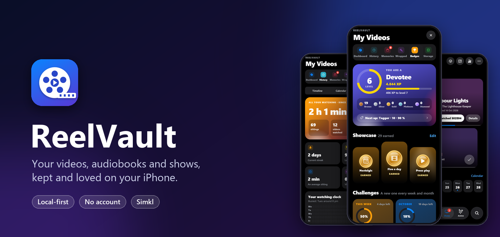
</p>

<p align="center">
  <a href="https://github.com/M7neeb/reelvault/releases/latest"></a>
  
  
  
  
  <a href="./LICENSE"></a>
</p>

<p align="center">
  <b>A local-first video and audio vault for iPhone.</b><br>
  Import your videos, audio and audiobooks, keep them in one place, and organise them with keywords,<br>
  ratings and search. Everything stays on the device: no account, no server, no telemetry.
</p>

<p align="center">
  <a href="#-highlights">Highlights</a> ·
  <a href="#-screenshots">Screenshots</a> ·
  <a href="#-features">Features</a> ·
  <a href="#-install-on-your-iphone">Install</a> ·
  <a href="#-development">Development</a>
</p>

---

## ✨ Highlights

<table>
  <tr>
    <td width="33%" valign="top">
      <h3>🔒 Yours, on the phone</h3>
      Every video, rating and note lives on the iPhone. A Private album with Face ID, weekly backups of all your info, and nothing sent anywhere.
    </td>
    <td width="33%" valign="top">
      <h3>🎬 A player that feels right</h3>
      Opens with its controls, goes full screen when you ask, and brings every control back over the video with a tap. Scrub previews, speed, loop, Up Next, AirPlay and picture in picture.
    </td>
    <td width="33%" valign="top">
      <h3>📊 Your watching, told well</h3>
      A dashboard, a history with a calendar and stats, Memories made into little films, a Wrapped for any range, and a trophy room of 90+ badges.
    </td>
  </tr>
  <tr>
    <td width="33%" valign="top">
      <h3>🎧 Audio and read-along</h3>
      Audiobooks with chapters, a sleep timer and bookmarks, plus EPUB 3 books where the sentence being read lights up as it plays.
    </td>
    <td width="33%" valign="top">
      <h3>📺 Simkl built in</h3>
      Up Next, this week's calendar, your own lists of movies, shows and anime, a Simkl dashboard and a Simkl Wrapped.
    </td>
    <td width="33%" valign="top">
      <h3>🗂️ Organised your way</h3>
      Keywords that nest, smart albums that fill themselves, forgiving search, duplicate clean-up and HashPhotos info brought across.
    </td>
  </tr>
</table>

## 📱 Screenshots

<table>
  <tr>
    <td align="center" width="33%">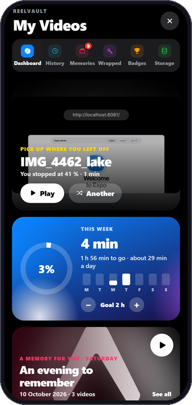<br><sub><b>Dashboard</b></sub></td>
    <td align="center" width="33%">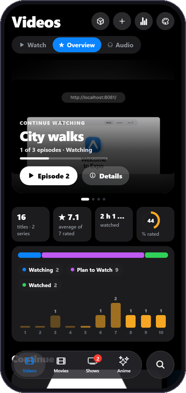<br><sub><b>Overview</b></sub></td>
    <td align="center" width="33%">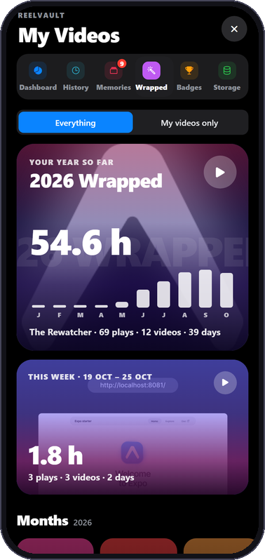<br><sub><b>Wrapped</b></sub></td>
  </tr>
  <tr>
    <td align="center" width="33%">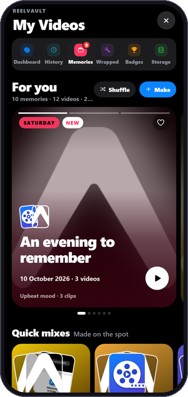<br><sub><b>Memories</b></sub></td>
    <td align="center" width="33%">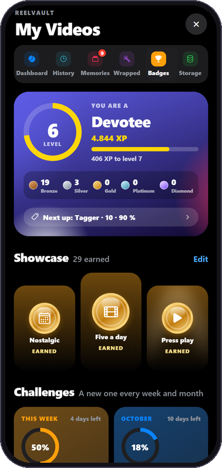<br><sub><b>Badges</b></sub></td>
    <td align="center" width="33%">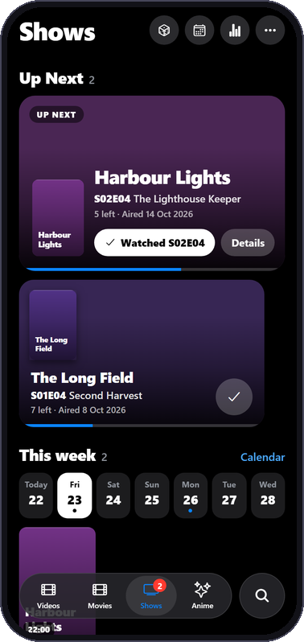<br><sub><b>Simkl</b></sub></td>
  </tr>
  <tr>
    <td align="center" width="33%">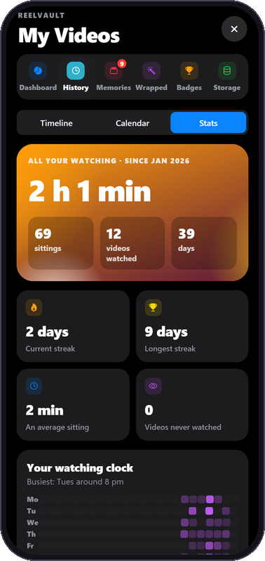<br><sub><b>History stats</b></sub></td>
    <td align="center" width="33%">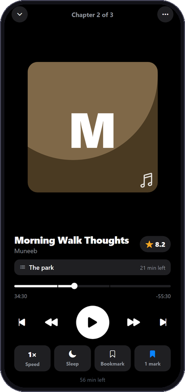<br><sub><b>Audio</b></sub></td>
    <td align="center" width="33%">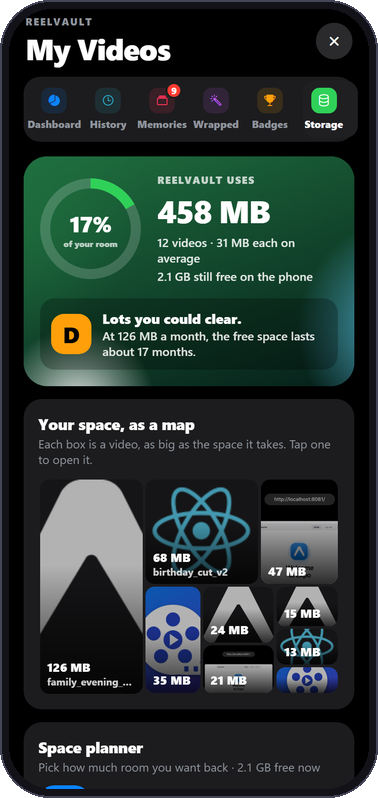<br><sub><b>Storage</b></sub></td>
  </tr>
</table>

<p align="center">
  
  <br><sub>Twelve app icons to choose from</sub>
</p>

## 🧩 Features

<details open>
<summary><b>📥 Import and library</b></summary>

- **Import** videos from the Files app, Photos, a whole folder, a link, a computer over Wi-Fi (drop videos on a page in the browser), or **Open in ReelVault** from any app that shares a video file (Files, Safari downloads, chat apps)
- **"Already in your library"** — importing a video or audio file you already have (the very same file, or one with the same length and picture size, or the same name and length) asks: replace the one you have (it keeps its rating, keywords and history), keep both, or don't import; one answer can cover the rest of the import
- **HashPhotos info** — read HashPhotos' metadata export (CSV, JSON or XML) and bring its dates (so the library is in the same order), keywords, ratings, titles, captions and flags across, matched by file name
- **Automatic thumbnails** and a scrubbable **filmstrip with a live playhead**
- **Cover frames** — scrub to the exact frame (a frame or a second at a time) and set it as the thumbnail
- **Library home rows** that play (recently added, your best, today's picks), **pinch the grid** to resize tiles, and grouping by day, week, month, year, rating, keyword, series or length with jump chips
- **Pinned shelf** at the top of the library (pin from the player's menu, hold to unpin)
- **Haven't watched in a year** shelf and a **Random** button that favours what you rarely see

</details>

<details>
<summary><b>🏷️ Organise, search and clean up</b></summary>

- **Keywords (tags)** with a browsable keyword cloud and a **keyword manager**: rename, merge, colour, nest ("Travel/Japan"), delete and clear unused ones
- **Quick tagging and Keep or delete** — swipe through videos to tag them or decide what goes, with undo
- **1–10 rating** per video
- **Sort** by date, rating, name, size, length, or most / least / last watched; albums by name, most watched or recently used
- **Collections** — All, Favorites, Rated, Untagged, plus per-keyword filters
- **Smart albums that fill themselves** — rules for rating, keywords (all or any), dates, length, size, shape and more, plus never watched, played N+ times, not watched in N days, watched lately, added or filmed in the last N days; one-tap templates
- **Forgiving search** that copes with typos and also finds bookmark names, with recent searches and suggestions; **smarter search** — plain words that filter: years and months, "8+", "long", "portrait", "#holiday", "unwatched", "last month", ">1gb"; the rest is searched as text
- **Duplicates and look-alikes** — review a group at a time; the best copy is kept and the others' keywords and rating carried over
- **Multi-select** with batch edits: ratings, flags, status, albums, several keywords at once, or take a keyword off all of them
- **Private album** with Face ID, its own passcode, a fake passcode and a log of wrong passcodes

</details>

<details>
<summary><b>▶️ Player</b></summary>

- **Player** — opens with the controls (or the video alone, or zoomed to fill: Open Videos in the player's menu) and never turns on its own; full screen sideways (turn the phone or tap the button) with every control over the video on a tap, hiding again by itself; a full-width playback bar, a soft glow of the video's colours around it, big play and 10-second buttons that fade while it plays, a frame preview while you scrub, pinch to fill, playback speed, loop, Up Next with a countdown, a screen lock, picture in picture and sound that keeps playing in the background
- **Viewer gestures** — swipe between videos, drag down to close, double-tap to jump 10 s, drag the bar to scrub
- **AirPlay** — play on an Apple TV or AirPlay TV from the viewer
- **Slideshow** — order, clip length, fade / zoom / slide transitions, titles, sound and repeat, with story bars and taps to move on

</details>

<details>
<summary><b>🎧 Audio and books</b></summary>

- **Audio section** (Audio mode of the Videos tab) — your own audio files and audiobooks (MP3, M4A, M4B, AAC, WAV, AIFF, CAF, FLAC, Opus) and **EPUB 3 books with read-along**: the sentence being read lights up as the narration plays, tap any sentence to play from there, adjustable text size
- Several files of one album become one book with a chapter per file; M4B and MP3 chapter marks are read
- A player with chapters, back 15 / forward 30, speed up to 3×, a sleep timer (minutes or the end of the chapter), bookmarks with notes, smart rewind after a pause, background play and the lock screen
- Ratings with decimals, status, keywords, notes, search, filters, sorting, Continue listening, select-to-edit, Private, Recently Deleted, listening stats, a year heat map and an Audio Wrapped
- **Light on storage**: a book is unpacked once, a piece at a time, straight into its folder (no second copy, nothing cached, nothing grows while you listen), covers are kept small, and the Storage page shows what it takes

</details>

<details>
<summary><b>📊 Stats, stories and badges</b></summary>

- **Dashboard** — tonight's pick playing at the top, this year against last year (the month and the year so far, month by month, your top video then and now), streaks with streak freezes (earned in good weeks, spent on a missed day), weekly goal ring with the week's days, pick up where you left off, records and the next milestone, a memory for you, things the app noticed, watch time against the period before, On this day memories, favourites to rediscover, habits, taste and ratings
- **History** — a timeline of everything you watched (search it, a 24-hour strip for each day, pick up what you didn't finish), a month calendar coloured by watch time, and Stats: a punch card of hours and days, streaks, month by month, a wall of what you rewatch and how much you finish
- **Year heat map** — a whole year of days as twelve little calendars, coloured by watch time
- **Memories** — your videos made into little films: on this day, a year ago this month, your first videos, milestones (your 100th video), after dark, trips away from home, big days, the best of each month and season, themes from your tags, favourites, forgotten gems and whole years, played as clips with sound in a Gentle, Upbeat or Epic mood; make your own from a keyword, album, dates and rating, or shuffle; quick mixes, trailers that play on the cards, and a clip grid and Up Next at the end; **then and now** plays a keyword or a place filmed years apart, old and new side by side
- **Wrapped** — your year, months, weeks or any range as a story that plays your own videos with sound: a guess-your-#1 quiz, a top-5 countdown and list, your #1 of every month, your video era, comfort video, biggest day, throwback, hidden gem, taste, habits, your video age, the rewatch meter, your watching club, this year against last year, your reviews and a persona; a Wrapped for one keyword, album or series
- **Badges** — a trophy room of 90+ badges: levels and XP, a full-screen reveal for each new badge, medals you can tilt, a showcase, weekly and monthly challenges, personal records, your journey, the badge road, and badges for memories, Wrapped, trips and secret dates
- **Live cards** — Dashboard, Memories, Wrapped and History cards play their video with sound while on screen (one at a time, with a mute button), showing the whole picture over a blurred copy of itself instead of a cropped zoom
- **Notifications** — a Sunday summary (your week, your #1 and your streak), On this day, the monthly Wrapped (the 1st), the yearly Wrapped (1 December), the weekly Wrapped, and new episodes from the Simkl calendar (a bell per title)

</details>

<details>
<summary><b>📺 Overview mode and Simkl</b></summary>

- **Overview mode** — rate and track your videos like shows (everything starts as To Watch; only you mark a video Watched, however much of it you have played), with a spotlight that plays and moves through your titles, rate-from-the-card, recently watched, Surprise Me, a status bar and your ratings 1–10; series with per-episode ratings, and the info of removed videos kept; a title page that plays the video, a chart of every episode's rating, episode progress, your review, rewatches with dates, Plan to Watch in the order you drag it into, and your stats (ratings month by month, finished fastest, most rewatched, where you changed your mind)
- **Simkl** — Up Next as a big card with a one-tap watched, this week's calendar and what is new this week on the home screen; stats with genres month by month, hours per show and how many shows you finish
- **Your own lists** of movies, shows and anime on every Simkl tab: **Add many** pastes a whole list of names (one per line) and finds each on Simkl; every title has a **Google** button, and the list keeps which ones you have searched (Not searched / Searched)
- **Simkl dashboard** — this week by day against last week, today / this month / this year, your streak, what is waiting in Up Next and how long it would take to finish, your year in days, the next milestones, your library by status, your top title this month and the last days you watched something
- **Simkl Wrapped** — a story of a year (or a month) of movies, shows and anime: your hours, the split between them, a guess-your-#1 quiz, your top five, your genres, your biggest binge, your busiest month, your longest streak, what you discovered and finished, your best rated, the kind of watcher you are, and a summary to share

</details>

<details>
<summary><b>💾 Storage and backups</b></summary>

- **Storage** — how full the phone is, a tidiness grade, big videos you rarely watch to shrink, how long the free space lasts, a map of your biggest videos, ways to free space, how the library grew, and size by quality, keyword, format and year
- **Make Smaller** — shrink videos to HEVC, including ones Apple's exporter rejects (such as game captures with broken frame timing)
- **Small on the phone** — covers and filmstrip frames saved small, a clean-up after every start (leftover temporary files, old frames), how much each part of the app takes with Clean up now, a space planner, Recently Deleted kept 1 to 30 days, and shrinking new imports
- **Backup of all your info** — ratings, keywords, albums, smart filters, series, watch history, bookmarks, where to continue, Simkl links and settings in one file; restoring adds to what is there and matches renamed videos
- **Automatic backups** of all your info every week (the last four kept), restorable in Settings and copied to a computer with the Apple Devices app
- **Quick with big libraries** — tested with 5,000 videos and 40,000 plays

</details>

<details>
<summary><b>🎨 Make it yours</b></summary>

- **Looks** — colour sets (Midnight, Graphite, Forest, Rose, Ember, or the colours of one of your videos), fonts, glass strength, round or square cards and outlines; **turn with the phone** so the whole app works sideways
- **Twelve app icons** — Classic, Midnight, Ocean, Aurora, Grape, Rose, Cherry, Sunset, Gold, Forest, Mint and Mono
- **Control Center button** (iOS 18) — links for a random favourite, today's memory or any video, to put in Control Center through a shortcut

</details>

## 📲 Install on your iPhone

ReelVault is installed as an `.ipa` with [SideStore](https://sidestore.io) (or AltStore), so no App Store or paid developer account is needed.

1. Download **`ReelVault.ipa`** from the [latest release](https://github.com/M7neeb/reelvault/releases/latest).
2. In SideStore, open **My Apps**, tap **+** and pick the file.
3. Open ReelVault and import your first videos.

Smaller updates arrive over the air: close and reopen the app once or twice and it picks them up, with your library untouched.

## 🛠️ Development

```bash
npm install
npx expo start
```

| Task | Command |
| --- | --- |
| Run the tests | `npm test` |
| Check types | `npx tsc --noEmit` |
| Web preview of any screen | `npx expo export -p web`, then open `/preview?view=<name>` |
| Build the `.ipa` | **Actions → iOS build → Run workflow** (or push a `v*` tag) |
| Send an update to the phone | **Actions → OTA update** (needs `EXPO_TOKEN`) |

<details>
<summary><b>Tech stack</b></summary>

- **Expo SDK 57** · **React Native 0.86** · **TypeScript** (strict)
- [`expo-router`](https://docs.expo.dev/router/introduction/) for navigation
- [`expo-sqlite`](https://docs.expo.dev/versions/latest/sdk/sqlite/) — WAL mode, **FTS5** full-text search kept in sync by triggers
- [`expo-video`](https://docs.expo.dev/versions/latest/sdk/video/) + [`expo-video-thumbnails`](https://docs.expo.dev/versions/latest/sdk/video-thumbnails/)
- [`expo-file-system`](https://docs.expo.dev/versions/latest/sdk/filesystem/) for app-owned storage
- Reanimated and Gesture Handler for the gestures
- Four small native Swift modules in [`modules/`](./modules): AirPlay, compress and edit videos, frames and colours, and Wi-Fi import

</details>

<details>
<summary><b>Project structure</b></summary>

Feature-first, so a change lives in one place:

```
src/app/                  screens (expo-router file-based routes)
  _layout.tsx             tabs shell + database initialisation
  preview.tsx             web preview of every screen
src/db/
  schema.ts               append-only migrations
  index.ts                open + migrate, single shared handle
src/features/vault/       videos, audio, player, stats, memories, wrapped, badges
src/features/simkl/       Simkl sign-in, lists, calendar, dashboard, Wrapped
src/features/home/        home screen
modules/                  native Swift modules
tests/                    unit tests (node --test)
```

See **[ARCHITECTURE.md](./ARCHITECTURE.md)** for the data model, migration policy and design decisions.

</details>

---

<p align="center">
  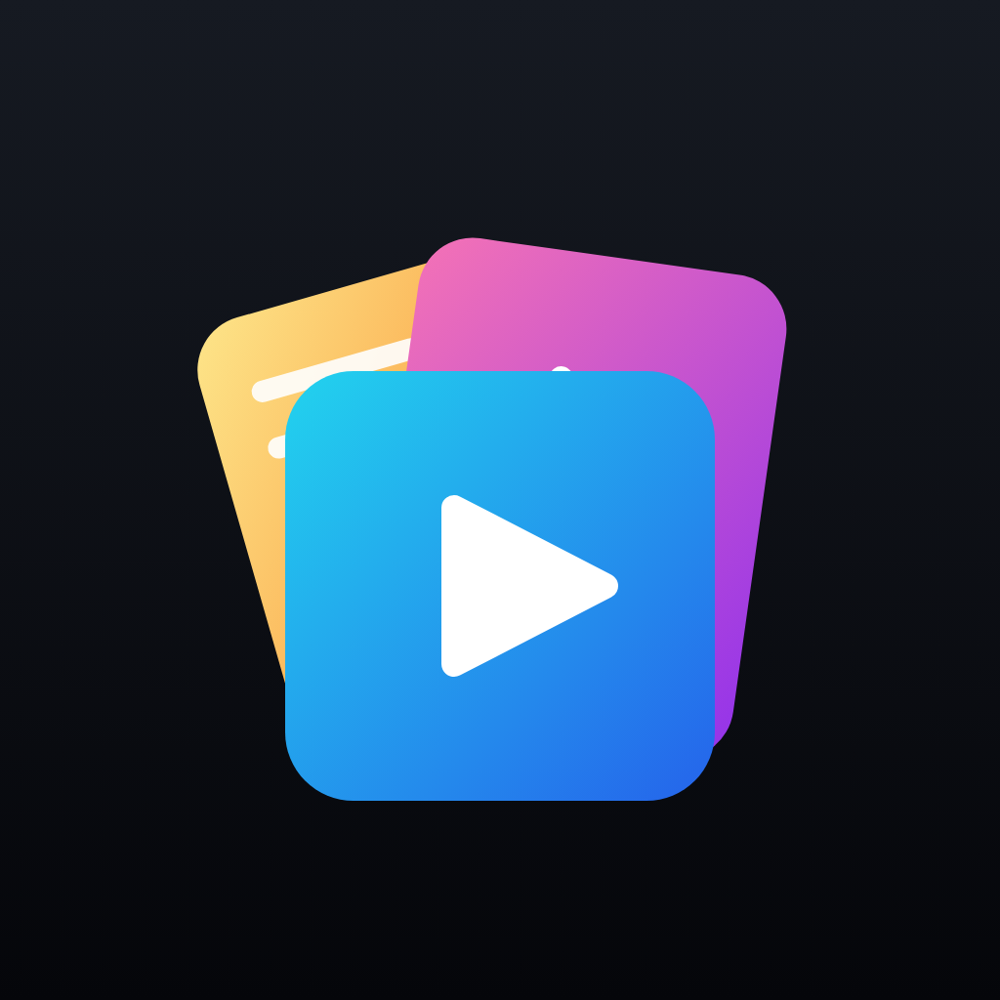<br>
  <sub>In daily use on an iPhone · version 1.10.0 · <a href="./LICENSE">MIT License</a></sub>
</p>
